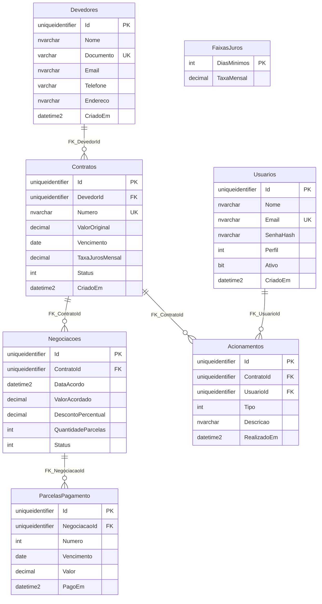

# Cobrança Web

Sistema de negociação e acompanhamento de cobranças, com uma aplicação ASP.NET MVC 5 para o fluxo legado, uma API ASP.NET Core 8 e SQL Server compartilhado.

## O que é o projeto

O sistema organiza devedores, contratos em aberto, negociações e parcelas. O atendente consulta contratos e acordos; os consumidores HTTP simulam ou efetivam negociações, consultam seu estado e registram pagamentos.

Este recorte integra o legado MVC 5 à operação atual: os dois consultam a mesma negociação no SQL Server. O consumidor antigo continua recebendo o total do acordo, enquanto a rota v2 também retorna o valor de cada parcela.

## Problema real

Uma negociação já registrada precisa continuar acessível ao atendente e aos sistemas que já consomem a API. Ao mesmo tempo, a operação nova precisa conhecer o valor e o vencimento de cada parcela para cobrar e reconciliar pagamentos. Alterar a resposta antiga poderia quebrar esse consumidor; calcular parcelas fora da regra do banco poderia deixar a soma diferente do total acordado.

## Objetivo

- Manter a consulta e o formato esperados pelo consumidor legado.
- Expor em v2 o detalhamento das parcelas da mesma negociação.
- Garantir que a soma das parcelas seja igual ao total, incluindo o centavo residual.
- Executar mudanças de estado por procedures e separar a identidade de migrations da credencial de runtime.
- Permitir retorno à leitura v1 durante a adoção da v2.

## Como os componentes interagem

O MVC 5 usa ADO.NET para consultar o banco e chamar a procedure de efetivação. Os consumidores v1 e v2 usam a API .NET 8; ambos passam pelo mesmo serviço e leem o mesmo acordo, mas recebem contratos de resposta diferentes. A infraestrutura acessa tabelas e procedures no SQL Server. Migrations são implantadas separadamente, usando uma identidade própria.

```mermaid
flowchart LR
    atendente[Atendente] --> mvc[ASP.NET MVC 5<br/>IIS + ADO.NET]
    clienteAntigo[Consumidor HTTP legado] -->|GET /api/v1/negociacoes/{id}<br/>total do acordo| v1[Leitura v1]
    clienteNovo[Consumidor HTTP novo] -->|GET /api/v2/negociacoes/{id}<br/>total e parcelas| v2[Leitura v2]

    v1 --> api[ASP.NET Core 8 API]
    v2 --> api
    api --> app[Application<br/>serviço de negociação]
    app --> dominio[Domain<br/>regras e entidades]
    app --> infra[Infrastructure<br/>EF Core + Dapper]

    mvc -->|consulta do acordo| banco[(SQL Server)]
    mvc -->|efetivação| procedures[[Stored procedures]]
    infra -->|consultas e gravações| banco
    infra -->|efetivação / pagamento| procedures
    procedures --> banco

    migra[Identidade de migrations] -->|EF Core database update| schema[Schema, procedures e grants]
    schema --> banco
    runtime[Identidade de runtime<br/>CobrancaApplicationRole] -.->|SELECT e EXECUTE concedidos| banco
```

As respostas v1 e v2 diferem na apresentação, não na negociação armazenada. Para R$ 100 em três parcelas, ambas mantêm `valorAcordado = 100`; a v2 apresenta `33,34`, `33,33` e `33,33`, cuja soma é R$ 100.

## Modelo de dados (DER)

O diagrama mostra as tabelas criadas pelas migrations. `Id` é `uniqueidentifier` nas entidades que herdam de `BaseEntity`.



## Banco de dados

Configure uma identidade de migração com `db_owner` durante a instalação/atualização do schema e uma identidade de aplicação associada ao papel `CobrancaApplicationRole`. A identidade de migração cria tabelas, procedures, papel e grants; não a use como connection string da aplicação. A aplicação tem leitura e inserções necessárias; mudanças de estado de negociação e parcela passam pelas procedures.

```powershell
dotnet tool install --global dotnet-ef --version 8.0.10
$env:ConnectionStrings__MigrationsConnection = 'Server=localhost;Database=CobrancaWeb;Integrated Security=True;TrustServerCertificate=True'
dotnet ef database update --project src/CobrancaWeb.Infrastructure --startup-project src/CobrancaWeb.Infrastructure
sqlcmd -S localhost -d CobrancaWeb -E -i database/seed_data.sql
```

Depois da migration, um administrador do SQL Server associa a identidade de execução ao papel da aplicação. No IIS local, crie o login para a identidade do pool e o usuário no banco:

```sql
CREATE LOGIN [IIS APPPOOL\CobrancaLegacyMvc] FROM WINDOWS;
USE CobrancaWeb;
CREATE USER [IIS APPPOOL\CobrancaLegacyMvc] FOR LOGIN [IIS APPPOOL\CobrancaLegacyMvc];
ALTER ROLE CobrancaApplicationRole ADD MEMBER [IIS APPPOOL\CobrancaLegacyMvc];
```

Associe a identidade do pool/API que hospeda o .NET 8 ao mesmo papel, ou use logins separados associados a ele. Não coloque a identidade de execução em `db_owner` nem em `db_datawriter`. A identidade de migração não deve ser usada como connection string da aplicação.

## Negociação v1/v2 e consulta MVC 5

O host legado está em `legacy/CobrancaWeb.LegacyMvc` e é ASP.NET MVC 5 em .NET Framework 4.8, com ADO.NET. Em Windows, instale .NET 8 SDK, .NET Framework 4.8 Developer Pack, IIS 10 com ASP.NET 4.8, .NET Extensibility 4.8, ISAPI Extensions e ISAPI Filters. O SQL Server deve ser 2019 ou mais recente.

Publique o MVC 5 e a API:

```powershell
dotnet publish legacy/CobrancaWeb.LegacyMvc/CobrancaWeb.LegacyMvc.csproj -c Release -o legacy/publish
$env:ConnectionStrings__DefaultConnection = 'Server=localhost;Database=CobrancaWeb;Integrated Security=True;TrustServerCertificate=True'
dotnet run --project src/CobrancaWeb.API
```

No IIS, crie um application pool **.NET CLR v4.0**, pipeline **Integrated**, com identidade Windows cadastrada em `CobrancaApplicationRole`, e aponte o site para `legacy/publish`. A connection string `CobrancaLegadoDb` fica em `legacy/publish/Web.config`; use a identidade do pool e ajuste o servidor conforme o ambiente. A consulta anterior é `GET /ConsultaCobranca/Index`; `GET /ConsultaCobranca/Negociacao/{id}` mostra uma negociação antiga com o total acordado.

Exemplo de criação do pool e site no Windows Server (PowerShell elevado):

```powershell
Install-WindowsFeature Web-Server, Web-Asp-Net45, Web-Net-Ext45, Web-ISAPI-Ext, Web-ISAPI-Filter -IncludeManagementTools
Import-Module WebAdministration
New-WebAppPool -Name CobrancaLegacyMvc
Set-ItemProperty IIS:\AppPools\CobrancaLegacyMvc -Name managedRuntimeVersion -Value v4.0
Set-ItemProperty IIS:\AppPools\CobrancaLegacyMvc -Name managedPipelineMode -Value Integrated
New-Website -Name CobrancaLegacyMvc -Port 8085 -PhysicalPath (Resolve-Path .\legacy\publish).Path -ApplicationPool CobrancaLegacyMvc
```

O contrato de leitura v1 mantém `GET /api/v1/negociacoes/{id}` e o campo `valorAcordado` consumido pelo cliente anterior. Ele não retorna parcelas. A v2 é `GET /api/v2/negociacoes/{id}` e inclui `parcelas` ordenadas por `numero`, cada uma com `id`, `numero`, `vencimento`, `valor` e `pagoEm`. O total do acordo permanece em `valorAcordado` nas duas versões.

Exemplo do corpo v1 preservado:

```json
{
  "id": "9e257495-8b18-4f3b-8f4b-9ca17c54f730",
  "contratoId": "8e8c2d74-c951-4e96-8824-2ea05d6d3925",
  "numeroContrato": "CT-100",
  "devedorNome": "Maria Silva",
  "dataAcordo": "2026-11-04T12:00:00Z",
  "valorAcordado": 100.00,
  "descontoPercentual": 0.00,
  "quantidadeParcelas": 3,
  "status": 1
}
```

A v2 acrescenta o detalhamento ao mesmo total:

```json
{
  "id": "9e257495-8b18-4f3b-8f4b-9ca17c54f730",
  "contratoId": "8e8c2d74-c951-4e96-8824-2ea05d6d3925",
  "numeroContrato": "CT-100",
  "devedorNome": "Maria Silva",
  "dataAcordo": "2026-11-04T12:00:00Z",
  "valorAcordado": 100.00,
  "descontoPercentual": 0.00,
  "quantidadeParcelas": 3,
  "status": 1,
  "parcelas": [
    { "id": "17cb4947-57b1-4847-a66a-626e4de6020d", "numero": 1, "vencimento": "2026-12-04T00:00:00", "valor": 33.34, "pagoEm": null },
    { "id": "389ca13f-54a2-4f65-97af-c24ee612534c", "numero": 2, "vencimento": "2027-01-04T00:00:00", "valor": 33.33, "pagoEm": null },
    { "id": "36b4b2ea-2c59-4c6f-91d0-b74830ae0e41", "numero": 3, "vencimento": "2027-02-04T00:00:00", "valor": 33.33, "pagoEm": null }
  ]
}
```

Para confirmar o total e cada parcela no SQL Server, use o mesmo ID enviado aos endpoints:

```sql
DECLARE @NegociacaoId uniqueidentifier = '9e257495-8b18-4f3b-8f4b-9ca17c54f730';

SELECT n.Id, n.ValorAcordado, p.Numero, p.Vencimento, p.Valor,
       SUM(p.Valor) OVER (PARTITION BY n.Id) AS SomaParcelas
FROM dbo.Negociacoes n
JOIN dbo.ParcelasPagamento p ON p.NegociacaoId = n.Id
WHERE n.Id = @NegociacaoId
ORDER BY p.Numero;
```

`SomaParcelas` deve ser igual a `ValorAcordado` em todas as linhas.

O `seed_data.sql` cria o contrato isolado `CT-TEST-100` (ID `dddddddd-dddd-dddd-dddd-dddddddddddd`, vencimento hoje, sem juros). Com um JWT válido, efetive uma negociação de três parcelas e use o ID retornado para consultar v1, v2 e MVC sobre o mesmo acordo:

```powershell
$token = 'JWT válido de um operador ativo'
$negociacao = Invoke-RestMethod -Method Post `
  -Uri http://localhost:5013/api/v1/negociacoes/efetivar `
  -Headers @{ Authorization = "Bearer $token" } `
  -ContentType 'application/json' `
  -Body '{"contratoId":"dddddddd-dddd-dddd-dddd-dddddddddddd","descontoPercentual":0,"quantidadeParcelas":3}'

./scripts/verify-negociacao-v1-v2.ps1 `
  -ApiBaseUrl http://localhost:5013 `
  -BearerToken $token `
  -NegociacaoId $negociacao.id `
  -LegacyBaseUrl http://localhost:8085
```

Para um acordo de R$ 100 em três parcelas, a regra publicada arredonda a parcela-base a centavos e aloca todo o resíduo na primeira: `round(100 / 3, 2) = 33,33`; `100 - (33,33 × 3) = 0,01`; parcelas `33,34`, `33,33`, `33,33`. O teste `EfetivarAsync_DeveRatearParcelasCorretamenteEAjustarDizimaDeCentavos` caracteriza a regra na aplicação; a verificação HTTP reconcilia os valores servidos pelo banco.

Execute a caracterização unitária no Windows com:

```powershell
dotnet test tests/CobrancaWeb.Tests/CobrancaWeb.Tests.csproj --filter FullyQualifiedName~EfetivarAsync_DeveRatearParcelasCorretamenteEAjustarDizimaDeCentavos
```

Com a connection string da identidade da aplicação em `ConnectionStrings__DefaultConnection`, execute o ensaio SQL usando um contrato em aberto. O script executa a procedure em transação e reverte os dados ao final; também exige erro 229 para `UPDATE` direto em `dbo.Contratos`:

```powershell
./scripts/verify-application-sql-permissions.ps1 -ContratoId 00000000-0000-0000-0000-000000000002
```

O ensaio SQL pode usar o mesmo `CT-TEST-100` antes de efetivar o acordo HTTP: ele reverte a transação e deixa o contrato aberto. Para repetir a demonstração HTTP depois da efetivação, restaure somente esse fixture com a identidade de manutenção:

```powershell
sqlcmd -S localhost -d CobrancaWeb -E -i database/reset_demo_negociacao.sql
```

O cliente pode voltar à rota anterior alterando a URL de leitura de `/api/v2/negociacoes/{id}` para `/api/v1/negociacoes/{id}`; a rota e o total v1 permanecem disponíveis durante a adoção da v2.
